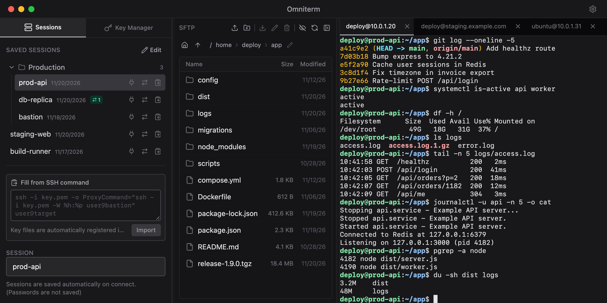

# OmniTerm

[English](README.md) | **한국어**

macOS 및 Windows용 통합 터미널 & SFTP 클라이언트. SSH(직접/바스천) 접속, 터미널 탭, SFTP 파일 탐색·드래그 앤 드롭 업로드를 한 창에서 할 수 있습니다.

- **홈페이지:** [chanwoong528.github.io/omniterm](https://chanwoong528.github.io/omniterm)
- **최신 릴리스:** [github.com/chanwoong528/omniterm/releases/latest](https://github.com/chanwoong528/omniterm/releases/latest)



---

## 주요 기능

- **SSH 직접 / 바스천 접속** — 서버에 직접 접속하거나 바스천(점프 호스트)을 거쳐 접속합니다. `ProxyCommand`를 쓰지 않고 세션 폼에서 두 서버를 각각 다른 키로 설정할 수 있습니다.
- **터미널 탭** — 여러 서버 세션을 탭으로 열어 한 창에서 오가며 작업할 수 있습니다. 터미널은 xterm.js 기반입니다.
- **SFTP 파일 탐색기** — 원격 파일을 탐색하고 패널에 끌어다 놓아 업로드합니다. 터미널 옆에 나란히 있어 별도 SFTP 앱이 필요 없습니다.
- **키 매니저** — SSH 키를 앱 안에서 한 번 등록해 두면 세션을 만들 때 목록에서 고르기만 하면 됩니다. 접속마다 키 경로를 입력할 필요가 없습니다.
- **세션 저장** — 접속 정보를 저장해 폴더로 묶어 두고, 클릭 한 번으로 다시 연결합니다.
- **macOS & Windows** — Tauri 기반 네이티브 앱으로 Apple Silicon·Intel Mac과 64비트 Windows에서 같은 화면을 제공합니다.

---

## 다운로드

**[홈페이지](https://chanwoong528.github.io/omniterm)** 에서 OS에 맞는 설치 파일을 바로 받을 수 있습니다. 또는 **[Releases](https://github.com/chanwoong528/omniterm/releases)** 에서 버전별 빌드 파일을 받을 수 있습니다.

| 플랫폼 | 파일 |
|---|---|
| macOS (Apple Silicon, M1 이상) | `Omniterm_<버전>_aarch64.dmg` |
| macOS (Intel) | `Omniterm_<버전>_x64.dmg` |
| Windows (64비트) | `Omniterm_<버전>_x64.exe` (설치 프로그램) 또는 `Omniterm_<버전>_x64.msi` |

OmniTerm은 아직 코드 서명이 되어 있지 않아, 처음 실행할 때 macOS와 Windows에서 보안 경고가 나옵니다. 아래 섹션을 참고하세요.

---

## "손상됨" 경고 없이 실행하기

앱이 실제로 손상된 것이 아니라, 인터넷에서 받은 서명되지 않은 앱에 대한 macOS·Windows의 기본 보안 정책 때문입니다. 아래 순서대로 하면 정상적으로 실행할 수 있습니다.

### macOS

DMG를 다운로드한 뒤 앱을 실행하려고 하면 macOS에서 **"손상되었기 때문에 열 수 없습니다"** 라는 메시지가 나올 수 있습니다. 아래 순서를 한 번만 따라 하면 됩니다.

#### 1. DMG에서 앱 복사하기

1. 다운로드한 DMG(예: **`Omniterm_<버전>_aarch64.dmg`**)를 **더블클릭**해서 디스크 이미지를 엽니다.
2. 열린 창에서 **OmniTerm.app**을 **응용 프로그램** 폴더로 드래그해서 복사합니다. (다른 폴더에 넣어도 됩니다.)

#### 2. 터미널에서 quarantine 속성 제거하기

**터미널**(Spotlight에서 "터미널" 검색 후 실행)을 연 뒤, 아래 중 앱을 넣은 위치에 맞는 명령을 **그대로 복사해서 실행**하세요.

- **응용 프로그램** 폴더에 넣었다면:
  ```bash
  xattr -cr /Applications/OmniTerm.app
  ```
- **다운로드** 폴더에 그대로 두었다면:
  ```bash
  xattr -cr ~/Downloads/OmniTerm.app
  ```
- **바탕화면** 등 다른 폴더에 넣었다면, `OmniTerm.app` 앞의 경로만 실제 위치로 바꿔서 실행하세요.
  ```bash
  xattr -cr ~/Desktop/OmniTerm.app
  ```

비밀번호를 물으면 Mac 로그인 비밀번호를 입력하면 됩니다. 설치할 때 한 번만 실행해 두면 됩니다.

#### 3. 앱 실행하기

이제 **OmniTerm.app**을 더블클릭해서 실행하면 "손상됨" 메시지 없이 열립니다.

### Windows

설치 프로그램을 실행했을 때 "Windows에서 PC를 보호했습니다" 경고가 나오면 **추가 정보** → **실행**을 선택하면 됩니다. 경고를 없애려면 코드 서명이 필요합니다. → [docs/WINDOWS-CODE-SIGNING.md](docs/WINDOWS-CODE-SIGNING.md)

---

## 개발

OmniTerm은 Tauri v2 앱입니다. 프런트엔드는 React, TypeScript, Tailwind CSS, xterm.js를, Rust 백엔드는 `ssh2`(libssh2)를 씁니다.

### 요구사항

- **Rust 1.85 이상** — Tauri v2 의존성이 2024 edition을 씁니다. [docs/RUST-VERSION.md](docs/RUST-VERSION.md) 참고.
- **Node.js 20.19 이상 또는 22.12 이상** — Vite 7이 지원하는 최소 버전입니다.
- **Tauri 시스템 의존성** — macOS는 Xcode Command Line Tools, Windows는 Microsoft C++ Build Tools와 WebView2가 필요합니다. [Tauri 사전 요구사항](https://v2.tauri.app/start/prerequisites/) 참고.

### 로컬에서 실행

```bash
npm install
npm run tauri:dev
```

### 주요 npm 스크립트

| 스크립트 | 설명 |
|---|---|
| `npm run dev` | Vite 개발 서버만 실행 |
| `npm run build` | TypeScript 빌드 + Vite 빌드 |
| `npm run lint` | ESLint 실행 |
| `npm run preview` | Vite 프리뷰 서버 |
| `npm run tauri` | Tauri CLI 직접 호출 |
| `npm run tauri:dev` | Tauri 앱 개발 모드 (프론트+백엔드) |
| `npm run tauri:build` | Tauri 프로덕션 빌드 |
| `npm run tauri:build:local` | 로컬 아키텍처만 빌드 (`CI=false`, macOS) |
| `npm run astro:dev` | `website/`의 랜딩 페이지 개발 서버 실행 |
| `npm run shots` | 실제 앱 UI로 랜딩 페이지 스크린샷을 찍어 `website/src/assets/screenshots/`에 저장 (설치된 Google Chrome 사용) |
| `npm run release:bump` | 버전 bump(`patch` / `minor` / `major`) 후 main 푸시·태그 푸시. 태그만 올리고 설치 파일은 빌드하지 않음 ([릴리스](#릴리스) 참고) |
| `npm run release:re` | 같은 버전의 태그를 다시 푸시 (인자: `v0.1.5 -d -y` 등, 사용법은 `scripts/re-release.sh` 참고). `release:bump`처럼 태그만 올림 |
| `npm run release:build` | 로컬에서 릴리스 빌드 실행 후 결과물 경로 출력 |

### 로컬에서 빌드 (설치용 파일 만들기)

**macOS – 본인 Mac과 같은 아키텍처만** 빌드할 때:

```bash
npm ci
npm run tauri:build:local
```

**macOS – Intel(x86_64)용을 Apple Silicon Mac에서** 빌드할 때는 먼저 타깃을 설치한 뒤 빌드하세요:

```bash
rustup target add x86_64-apple-darwin
npm run tauri build -- --target x86_64-apple-darwin
```

**Windows** 에서 빌드할 때:

```bash
npm ci
npm run tauri build
```

생성 위치:

- **macOS 앱:** `src-tauri/target/release/bundle/macos/Omniterm.app`
- **macOS DMG:** `src-tauri/target/release/bundle/dmg/`
- **Windows:** `src-tauri/target/release/bundle/msi/` 또는 `nsis/`

`--target`을 붙여 빌드하면 `src-tauri/target/<타깃>/release/bundle/` 아래에 생성됩니다.

---

## 릴리스

GitHub Actions 워크플로 두 개가 관여합니다.

- **Bump Version** (`.github/workflows/bump-version.yml`) — `main`에 푸시할 때마다 패치 버전을 올리고 태그를 푸시합니다. head 커밋 메시지에 `[skip ci]`가 있거나 `website/**`·`.github/**`만 바뀌었으면 건너뜁니다.
- **Release** (`.github/workflows/release.yml`) — macOS(Apple Silicon, Intel)와 Windows x64를 빌드해 GitHub Release에 올립니다. 태그가 가리키는 커밋 메시지에 `[skip release]`가 있으면 빌드를 건너뜁니다.

릴리스 커밋에는 Bump Version이 버전을 또 올리지 않도록 `[skip ci]`가 필요합니다. 그런데 GitHub은 태그 푸시에도 `[skip ci]`를 적용하므로, **태그를 푸시해도 빌드가 시작되지 않습니다.** 태그를 대상으로 직접 실행해야 합니다.

```bash
# 1. package.json, src-tauri/tauri.conf.json, src-tauri/Cargo.toml에 같은 버전을 넣고
#    두 lockfile을 다시 만든다
npm install --package-lock-only
(cd src-tauri && cargo check)

# 2. [skip ci]를 넣어 커밋한다. [skip release]는 절대 넣지 않는다
git add package.json package-lock.json src-tauri/tauri.conf.json \
        src-tauri/Cargo.toml src-tauri/Cargo.lock
git commit -m "chore: release vX.Y.Z [skip ci]"
git push origin main

# 3. 태그를 만들어 푸시한다
git tag vX.Y.Z && git push origin vX.Y.Z

# 4. 태그를 대상으로 빌드를 시작하고 끝날 때까지 지켜본다
gh workflow run release.yml --ref vX.Y.Z
gh run watch <run-id> --exit-status

# 5. 빌드가 성공한 뒤 자동 생성된 릴리스 노트를 교체한다
gh release edit vX.Y.Z --notes-file <file>
```

`npm run release:bump`와 `npm run release:re`는 커밋에 `[skip release]`를 넣으므로, 설치 파일 없이 태그만 올릴 때만 씁니다. 문서만 바꿔 `main`에 푸시할 때도 `[skip ci]`를 넣어야 쓸데없는 버전이 생기지 않습니다.

릴리스 노트 형식을 포함한 전체 규칙은 [CLAUDE.md](CLAUDE.md)의 "Releasing", "Release notes" 섹션에 있습니다. 같은 버전 다시 빌드하기, 태그만 올리기까지 담은 단계별 안내는 [docs/RELEASE-STEPS.md](docs/RELEASE-STEPS.md)에 있습니다.

---

## 라이선스

[MIT](LICENSE)
