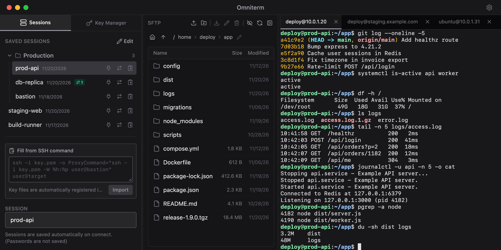

# OmniTerm

**English** | [한국어](README.ko.md)

A terminal and SFTP client for macOS and Windows. Connect over SSH directly or through a bastion host, keep several servers open in tabs, and move files with drag and drop, all from one window.

- **Homepage:** [chanwoong528.github.io/omniterm](https://chanwoong528.github.io/omniterm)
- **Latest release:** [github.com/chanwoong528/omniterm/releases/latest](https://github.com/chanwoong528/omniterm/releases/latest)



---

## Features

- **Direct or bastion SSH** — Connect to a server directly or through a bastion (jump host). You set up both hops in the session form, each with its own key, instead of writing a `ProxyCommand`.
- **Terminal tabs** — Open sessions to several servers as tabs and switch between them in one window. The terminal is built on xterm.js.
- **SFTP file explorer** — Browse remote files and upload by dropping them onto the panel. It sits next to the terminal, so you don't need a separate SFTP app.
- **Key manager** — Register your SSH keys once in the app, then pick one from a list when you set up a session instead of typing a key path every time.
- **Saved sessions** — Save connection details, group them in folders, and reconnect with one click.
- **macOS and Windows** — A native Tauri app with the same interface on Apple Silicon and Intel Macs and on 64-bit Windows.

---

## Download

Get the installer for your OS from the [homepage](https://chanwoong528.github.io/omniterm), or pick a version on the [Releases](https://github.com/chanwoong528/omniterm/releases) page.

| Platform | File |
|---|---|
| macOS (Apple Silicon, M1 or later) | `Omniterm_<version>_aarch64.dmg` |
| macOS (Intel) | `Omniterm_<version>_x64.dmg` |
| Windows (64-bit) | `Omniterm_<version>_x64.exe` (installer) or `Omniterm_<version>_x64.msi` |

OmniTerm is not code-signed yet, so macOS and Windows show a security warning the first time you open it. See the next section.

---

## Running without the "damaged" warning

The app is not actually damaged. macOS and Windows block unsigned apps downloaded from the internet by default, and the steps below tell them to let OmniTerm run.

### macOS

After you download the DMG and try to open the app, macOS may say the app **is damaged and can't be opened**. Follow these steps once.

#### 1. Copy the app out of the DMG

1. **Double-click** the DMG you downloaded (for example `Omniterm_<version>_aarch64.dmg`) to open the disk image.
2. Drag **OmniTerm.app** from the window that opens into your **Applications** folder. Any other folder works too.

#### 2. Remove the quarantine attribute in Terminal

Open **Terminal** (search for "Terminal" in Spotlight), then copy and run the command that matches where you put the app.

- If you put it in **Applications**:
  ```bash
  xattr -cr /Applications/OmniTerm.app
  ```
- If you left it in **Downloads**:
  ```bash
  xattr -cr ~/Downloads/OmniTerm.app
  ```
- If you put it somewhere else, such as the **Desktop**, replace the path before `OmniTerm.app` with the real location:
  ```bash
  xattr -cr ~/Desktop/OmniTerm.app
  ```

If Terminal asks for a password, enter your Mac login password. You only need to run this once per install.

#### 3. Open the app

Double-click **OmniTerm.app**. It now opens without the "damaged" message.

### Windows

If SmartScreen shows **Windows protected your PC** after you run the installer, choose **More info → Run anyway**. The warning goes away only once the installer is code-signed; see [docs/WINDOWS-CODE-SIGNING.md](docs/WINDOWS-CODE-SIGNING.md) (in Korean).

---

## Development

OmniTerm is a Tauri v2 app. The front end uses React, TypeScript, Tailwind CSS and xterm.js; the Rust backend uses `ssh2` (libssh2).

### Requirements

- **Rust 1.85 or later** — Tauri v2 dependencies use the 2024 edition. See [docs/RUST-VERSION.md](docs/RUST-VERSION.md) (in Korean).
- **Node.js 20.19+ or 22.12+** — the minimum Vite 7 supports.
- **Tauri system dependencies** — Xcode Command Line Tools on macOS, Microsoft C++ Build Tools and WebView2 on Windows. See the [Tauri prerequisites](https://v2.tauri.app/start/prerequisites/).

### Run locally

```bash
npm install
npm run tauri:dev
```

### npm scripts

| Script | What it does |
|---|---|
| `npm run dev` | Starts only the Vite dev server |
| `npm run build` | Type-checks with TypeScript, then builds with Vite |
| `npm run lint` | Runs ESLint |
| `npm run preview` | Starts the Vite preview server |
| `npm run tauri` | Calls the Tauri CLI directly |
| `npm run tauri:dev` | Runs the Tauri app in development mode (front end and backend) |
| `npm run tauri:build` | Builds the Tauri app for production |
| `npm run tauri:build:local` | Builds for this machine's architecture only, with `CI=false` (macOS) |
| `npm run astro:dev` | Starts the dev server for the landing page in `website/` |
| `npm run shots` | Captures the landing-page screenshots from the real app UI into `website/src/assets/screenshots/` (uses the installed Google Chrome) |
| `npm run release:bump` | Bumps the version (`patch` / `minor` / `major`), then pushes `main` and a tag. Tag only: it does not build installers (see [Releasing](#releasing)) |
| `npm run release:re` | Re-pushes the tag for an existing version (for example `v0.1.5 -d -y`; usage is in `scripts/re-release.sh`). Tag only, like `release:bump` |
| `npm run release:build` | Runs a local release build and prints where the output files are |

### Build locally

To build an installer for **the same architecture as your Mac**:

```bash
npm ci
npm run tauri:build:local
```

To build for **Intel (x86_64) on an Apple Silicon Mac**, add the target first:

```bash
rustup target add x86_64-apple-darwin
npm run tauri build -- --target x86_64-apple-darwin
```

On **Windows**:

```bash
npm ci
npm run tauri build
```

Output:

- **macOS app:** `src-tauri/target/release/bundle/macos/Omniterm.app`
- **macOS DMG:** `src-tauri/target/release/bundle/dmg/`
- **Windows:** `src-tauri/target/release/bundle/msi/` or `nsis/`

A build with `--target` writes to `src-tauri/target/<target>/release/bundle/` instead.

---

## Releasing

Two GitHub Actions workflows are involved:

- **Bump Version** (`.github/workflows/bump-version.yml`) runs on every push to `main`, bumps the patch version and pushes a tag. It is skipped when the head commit message contains `[skip ci]`, or when only `website/**` or `.github/**` changed.
- **Release** (`.github/workflows/release.yml`) builds macOS (Apple Silicon and Intel) and Windows x64 and uploads them to the GitHub Release. It skips the build if the tagged commit's message contains `[skip release]`.

A release commit needs `[skip ci]` so Bump Version doesn't bump again. GitHub also honors `[skip ci]` on the tag push, so **pushing the tag does not start the build**. You start it by hand on the tag:

```bash
# 1. Set the same version in package.json, src-tauri/tauri.conf.json and src-tauri/Cargo.toml,
#    then regenerate both lockfiles
npm install --package-lock-only
(cd src-tauri && cargo check)

# 2. Commit with [skip ci], and never with [skip release]
git add package.json package-lock.json src-tauri/tauri.conf.json \
        src-tauri/Cargo.toml src-tauri/Cargo.lock
git commit -m "chore: release vX.Y.Z [skip ci]"
git push origin main

# 3. Tag and push
git tag vX.Y.Z && git push origin vX.Y.Z

# 4. Start the build on the tag and wait for it
gh workflow run release.yml --ref vX.Y.Z
gh run watch <run-id> --exit-status

# 5. After the build succeeds, replace the generated release notes
gh release edit vX.Y.Z --notes-file <file>
```

`npm run release:bump` and `npm run release:re` add `[skip release]` to their commit, so use them only when you want a tag without installers. Docs-only pushes to `main` also need `[skip ci]`, or Bump Version mints a new version for them.

The full rules, including the release-note format, are in the "Releasing" and "Release notes" sections of [CLAUDE.md](CLAUDE.md). A step-by-step guide that also covers rebuilding a version and tag-only releases is in [docs/RELEASE-STEPS.md](docs/RELEASE-STEPS.md) (in Korean).

---

## License

[MIT](LICENSE)
